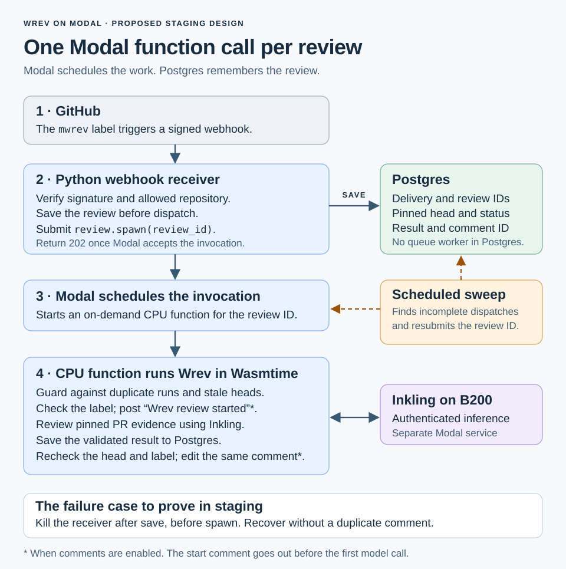

# Wrev on Modal: production plan

> Historical rollout plan. See [README.md](README.md) for current scope and runtime configuration.

**Status: proposed.** This replaces the Go queue proposal in [PR #2](https://github.com/r33drichards/wrev-inkling-modal/pull/2). [PR #1](https://github.com/r33drichards/wrev-inkling-modal/pull/1) is a smoke test, not the service or a merge prerequisite. No deployment, GitHub App install, webhook change, or traffic cutover is part of this PR.

## Decision

Use a thin Python ASGI webhook on Modal, one on-demand Modal CPU invocation per review ID, and a separate authenticated B200 inference service. Keep Postgres for review state, deduplication, and recovery, not as a queue that workers poll continuously. The receiver dispatches with Modal's `.spawn()`; a scheduled repair task only handles incomplete dispatches or attempts. Retain the vendored Go worker as a reference for signature, event, evidence, and comment behavior; don't add a Go-to-Python bridge to the launch path. Keep Wrev's Rust/Wasm reviewer and Wasmtime distribution.

References: [PR-Agent's GitHub App](https://github.com/The-PR-Agent/pr-agent/blob/main/pr_agent/servers/github_app.py) separates ingress from execution; borrow the handoff, not its in-process fallback. [Modal Functions](https://modal.com/docs/guide/functions) provide async invocation. If reconciliation proves too complex and Postgres needs to own scheduling, revisit [transactional enqueueing with River](https://riverqueue.com/docs/transactional-enqueueing) instead of building a general queue.

## The request and review lifecycle

1. **Receive and persist.** Verify GitHub's HMAC over the raw body before parsing, enforce body size and installation/repo allowlists, and record the delivery and review intent in one Postgres transaction. An exact `mwrev` label addition on an open PR (including a draft) starts a review. Label removal or PR close cancels it; a new head supersedes it and can start a replacement while the label remains. Do not trust webhook arrival order: recheck current PR state before dispatch work becomes visible on GitHub. Deduplicate delivery IDs and active reviews for the same repo, PR, head and label activation; re-adding the label creates a new activation.
2. **Dispatch.** Submit only the review ID with `review.spawn(review_id)` after commit. Return `202` once Modal accepts the invocation; do not wait for a worker or GPU. Save the Modal call ID when available. Duplicates already submitted or completed can be acknowledged without another invocation. If dispatch isn't confirmed within the webhook deadline, return a retryable error and retain the row for repair. Do not assume GitHub will redeliver a failed event. See [GitHub's webhook guidance](https://docs.github.com/en/webhooks/using-webhooks/best-practices-for-using-webhooks).
3. **Start and review.** The CPU function conditionally acquires that review ID, checks that the PR is open and still has the expected head and label, then publishes **Wrev review started** before the first model call when commenting is enabled. Pin base/head and stage bounded evidence without executing PR code or build scripts. Run the pinned Wrev component in Wasmtime with only per-review evidence and scratch access. The guest gets no GitHub or database secrets and no arbitrary network access. Route model requests through a trusted authenticated gateway. Make provider configuration explicit; don't patch an endpoint into Wrev at runtime.
4. **Finish.** Validate findings and file/line references and persist the outcome before publishing it. Recheck PR state before publishing findings. Edit the original start comment with the result, failure, cancellation, or supersession, scoped to the reviewed revision. Do not publish stale findings or remove the label automatically at launch. An evidence failure, output-schema failure, or exhausted review budget is a failed review, not a clean one.

## Recovery and safe retries

- **Dispatch is not an atomic cross-service transaction.** The receiver can die before spawning, or after Modal accepts the call but before the call ID reaches Postgres. A scheduled Modal sweep finds aged, unconfirmed dispatches and resubmits by ID with bounded backoff. An atomic state transition and attempt token stop duplicate invocations and superseded workers from committing a result. A missed wake is recoverable; exactly-once execution is not assumed.
- **Recover incomplete runs.** Use a bounded attempt deadline (aligned with the Modal timeout), release or replace expired attempts, and cap retries. Keep persisted outcomes separate from unfinished GitHub writes so a comment retry doesn't rerun inference. Start from pinned evidence on a fresh attempt rather than promising partial inference resume. Record terminal failures for inspection and manual retry.
- **Reconcile comments.** Write a deterministic marker for the review, persist its GitHub comment ID, and serialize writes for the PR. On ambiguous POST success, find an app-authored comment with that marker before retrying; don't blindly POST again. Use short-lived, scoped GitHub App installation tokens on the host. Sanitize comments and never include prompts, credentials, or raw error details. If the start comment cannot be confirmed in comment-enabled mode, don't start inference.

## Deployment and launch gates

| Phase | What must be demonstrated |
| --- | --- |
| 1. CPU contract tests | Signed and invalid deliveries, wrong repo, duplicate dispatch, stale/reordered events, cancellation and re-label, Postgres outage; mock model exercises real Wasmtime, streaming tool results, schema validation and limits. |
| 2. Durable recovery | Crash between commit and spawn; crash after spawn but before saving the call ID; interrupt a running CPU function; lose the GitHub POST response after success. Verify accepted reviews recover, duplicate invocations don't produce duplicate comments, and stale attempts cannot publish findings. |
| 3. Deployed staging | Separate database, Modal environment and test GitHub App installation. Send real `mwrev` label events on fixture PRs, one clean and one with a seeded non-security correctness bug. Confirm the start comment appears before the GPU call and is edited in place. Exercise cold/warm B200 and a deploy during active work. |
| 4. Production canary | One approved repo and one B200 maximum. Start with `mwrev` and writes off, then enable comments for only that repo. Verify Modal ignores `wrev` and Railway ignores `mwrev`. Leave Railway's existing `wrev` trigger unchanged. |

**Inference:** Use a pinned Inkling 2 Mini checkpoint, pinned compatible vLLM image and Inkling parsers on one B200 (TP1); keep weights on a private Modal Volume and scale the GPU to zero. Keep `--max-model-len` and `--max-num-seqs` unset. Bound requests and review concurrency at the application boundary. Set the Wrev model timeout to 180 seconds and script memory and output to 100 MiB each; the gateway and public comment have their own smaller budgets. Verify cold-start readiness independently of the model-request deadline, and reserve a final schema-constrained turn once evidence has been read. See the [Modal vLLM example](https://modal.com/docs/examples/vllm_inference) and the [Inkling B200 recipe](https://recipes.vllm.ai/thinkingmachines/Inkling-2-Mini?hardware=b200&features=reasoning%2Cspec_decoding%2Ctool_calling).

**Operate and roll back:** Track delivery ID → review ID → Modal call ID → comment ID without logging secrets or PR content. For the canary, target p95 acknowledgment below 2 seconds and no accepted request above 8 seconds, zero lost accepted deliveries, no duplicate/stale findings comments, and measurable recovery within two sweep intervals after eligibility. Record cold/warm latency and billed GPU seconds; agree a spending cap before expanding. Provide pause switches for dispatch, publication, and GPU calls. To roll back, pause and fence Modal work and publication, reconcile accepted reviews, then disable the `mwrev` trigger. Railway's `wrev` remains available as a manual fallback; do not automatically replay `mwrev` jobs through Railway.

**Evidence so far:** The [B200 smoke run](https://modal.com/apps/r33drichards/main/ap-DbkSFMRAqN4EF60Smubzv3) processed a synthesized signed event against a real PR and returned valid empty findings. The [start-to-result edit](https://github.com/r33drichards/webhook/pull/11#issuecomment-7207583860) was verified separately. Neither proves the Python ingress, Modal dispatch repair, production GitHub credentials, or automated comment lifecycle.
