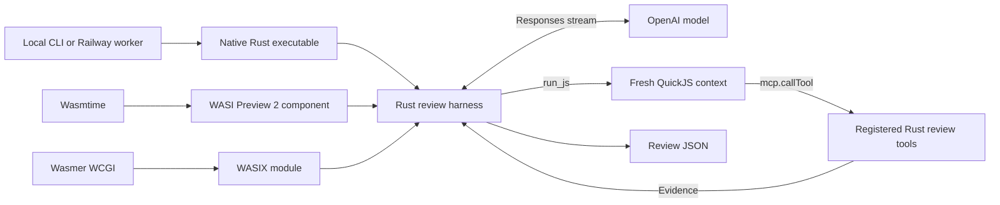
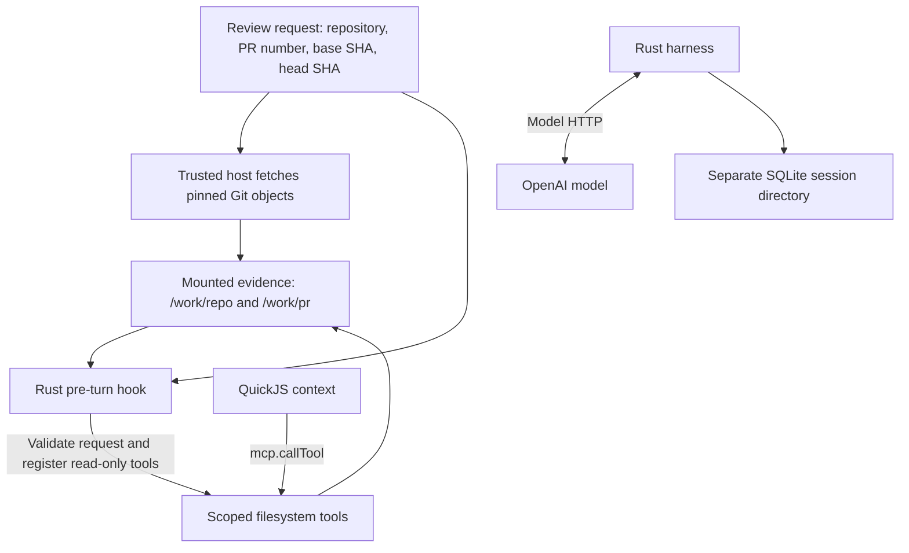

# Wrev

Wrev reviews GitHub pull requests against pinned commits. Run it locally to
get structured findings, or apply the `wrev` label to run it through the
Railway worker. Wrev uses a Rust review harness with embedded QuickJS and
authenticates model requests through Sign in with ChatGPT.

## Run locally

You’ll need Git and a GitHub token with read access to **Contents** and **Pull
requests** for the repository. An unpublished fork commit must also be
accessible to the credential.

```sh
nix-shell -p cargo rustc cmake pkg-config --run 'cargo build --locked --bin wrev'
./target/debug/wrev login
./target/debug/wrev models
```

Set `WREV_GITHUB_TOKEN` through your secret manager. Choose a slug from
`wrev models` and run the review.

```sh
OPENAI_MODEL='your-model-slug' ./target/debug/wrev review OWNER/REPO 123
```

The native CLI fetches the base and head into a temporary bare Git repository
and returns JSON on stdout. The `reviewbench CHECKOUT PR_JSON` command uses the
same snapshot reviewer with a supplied checkout. Build with
`--features sqlite-backend` and set `WREV_SESSION_DIR` to save checkpoints.
See [build instructions](BUILD.md) and [checkpoint recovery](docs/durability.md).

## Architecture

### Runtime and harness

The host runs the Rust harness. The model calls `run_js` to inspect evidence
through Rust tools registered for the current PR. QuickJS executes that
JavaScript in a fresh context for each call.



### Filesystem and security boundaries



- **Snapshot.** The host materializes the pinned head checkout and supplies
  `/work/pr/pr.json` and `/work/pr/diff.patch` in ReviewBench's layout.
  Wrev adds the pinned base tree at `/work/base`. The hook runs before
  the first model or tool call, including during recovery.
- **QuickJS.** Review scripts use `fs.readText()` and `fs.listDir()` to
  read the staged evidence, with execution time, memory, stack, source,
  and output limits. The bridge rejects traversal, symlinks, and paths
  outside the review inputs.
- **Review instructions.** The model checks code quality, security,
  performance, testing, and documentation. The harness asks it to read
  every diff page and back each finding with evidence.
- **Runtime.** Native Wrev stages evidence in a private temporary directory.
  Wasm hosts provide a per-review mount. Wasmtime uses WASI HTTP for model
  requests and can preopen a separate directory for SQLite checkpoints.

- **Webhook.** Verify the GitHub signature and scope incoming events to the
  configured repositories or owner. Railway uses separate credentials for
  reading PRs and writing comments or removing the trigger label.

## Listen for the label

The [Railway worker](https://github.com/r33drichards/webhook/blob/master/docs/Railway-wrev.md)
queues signed GitHub events on its own service. Applying `wrev` posts a start
comment when commenting is configured. Wrev updates the same comment with the
findings and removes the trigger label after a successful review. Removing the
label during a review cancels it. Operators can inspect stored results at
`GET /admin/reviews`.

The Wasmer WCGI listener handles `POST /github/webhook` inline. The host must
prepare and mount a snapshot for that delivery at `WREV_SNAPSHOT_DIR`. Wrev
checks the mount against the signed event before reviewing. Configure
`WREV_REPOSITORIES` and `WREV_WEBHOOK_SECRET` and use `GET /health` to check
configuration. Successful matching deliveries return HTTP 204 and emit review
JSON to stderr. GitHub expects a webhook response within 10 seconds, which is
shorter than some reviews. A redelivery can run the review again. The Wasmtime
component can also be invoked by a separate webhook server. See
[Wasm build and deployment instructions](BUILD.md).

## Production releases

A push to `wrev/main` runs one pin-update job at a time. It opens or updates a
worker PR with the latest merged Wrev SHA. Merging the worker PR triggers
Railway to build from `webhook/master`. The worker Dockerfile pin controls the
reviewer version. The Wrev repository's `WREV_WORKER_TOKEN` Actions secret
needs **Contents** and **Pull requests** write access on the worker repo.

## ReviewBench results

Wrev and the Codex CLI each reviewed the same 219 frozen pull requests from the
[ReviewBench full corpus](https://github.com/review-bench/ReviewBench/blob/082f65f6746c39b6ac25b0a62c1b0d5131a3803a/corpus/manifest.json)
with GPT-6 Luna (`gpt-6-luna`). The
[ReviewBench offline judge](https://github.com/review-bench/ReviewBench/blob/082f65f6746c39b6ac25b0a62c1b0d5131a3803a/docs/OFFLINE_EVAL.md)
used GPT-6.1 Terra (`gpt-6.1-terra`) to match and classify findings.
The table shows micro-averaged results from one local run per reviewer.
Wrev used the direct QuickJS filesystem tools and expanded review instructions.
Both runs completed all 219 pull requests and used the same judge, scoring
prompts, and golden set. See the [ReviewBench methodology](docs/reviewbench-methodology.md)
for the reviewer setup and metric definitions.

| Metric | Wrev | Codex CLI |
| --- | ---: | ---: |
| Findings submitted | **331** | 209 |
| Grounded precision | **86.4%** | 83.2% |
| Grounded recall | **7.8%** | 4.7% |
| Augmented precision | **75.5%** | 70.8% |
| Augmented recall | **10.6%** | 6.1% |
| False positives (% of submissions) | **81 (24.5%)** | 61 (29.2%) |
| Novel true positives | **79** | 39 |

### Resource usage sample

A separate run measured three matched PRs with GPT-6 Luna, one review at a time.
Wrev used debug builds on macOS. The Wasmtime 39.0.1 runs used WASI Preview 2
with the compiled-module cache disabled for cold runs and populated for warm
runs. Elapsed times exclude checkout and snapshot preparation and Terra scoring.

| Average per task | Wrev native | Wrev Wasmtime cold | Wrev Wasmtime warm | Codex CLI native | Codex CLI in Docker |
| --- | ---: | ---: | ---: | ---: | ---: |
| Elapsed review time | 19.68 s | 21.92 s | 18.75 s | 12.67 s | 24.68 s |
| CPU time | 0.48 s | 3.62 s | 0.41 s | 2.86 s | 9.52 s |
| Peak RSS | 15.9 MiB | 170.3 MiB | 71.3 MiB | 285.7 MiB | 385.3 MiB |
| Input tokens | 35,516 | 42,859 | 38,386 | 34,202 | 80,442 |
| Cached input tokens | 2,944 | 6,528 | 1,920 | 22,229 | 64,683 |
| Estimated model cost | $0.00358 | $0.00398 | $0.00395 | $0.00157 | $0.00260 |

Both Codex runs used CLI v0.159.3. Native Codex ran on arm64 macOS with the
read-only sandbox, timed with macOS `time`. The Docker run used an amd64
Linux container on the same Mac. GNU time measured the review command and
its subprocesses, excluding the adapter's sign-in check and Docker startup.
The native and containerized runs differ in architecture, sandboxing, and
model traces, so the timing gap measures the two setups end to end.

The full Codex container averaged **26.47 s elapsed**, **11.16 s CPU**, and
**339.4 MiB peak cgroup memory**. About **1.64 CPU seconds** per review were
spent outside the Codex command inside the container, including the adapter
and sign-in check.

An empty container using the same image averaged **0.19 s from
launch through exit**, **0.05 s guest CPU**, and **3.6 MiB
peak cgroup memory**. Guest CPU measurements exclude the Docker VM host
process. RSS and cgroup memory use different accounting, so subtracting their
peaks would not isolate Docker's memory overhead.

Model cost is a Standard API equivalent from recorded input, cached input,
and output tokens. The reviews used ChatGPT sign-in. [GPT-6 Luna pricing](https://developers.openai.com/api/docs/models/gpt-6-luna)

## Configuration

Set `OPENAI_MODEL` for reviews. Native `review` and `prepare-review` use
`WREV_GITHUB_TOKEN` for host-side preparation. Noninteractive
runtimes can receive a Sign in with ChatGPT access token through
`CHATGPT_ACCESS_TOKEN`. Timeouts and byte limits must be positive integers.

| Variable | Default | Scope |
| --- | ---: | --- |
| `WREV_MODEL_TIMEOUT_SECS` | 180 | One model or model-catalog HTTP request |
| `WREV_GITHUB_TIMEOUT_SECS` | 20 | One GitHub API request |
| `WREV_SCRIPT_TIMEOUT_SECS` | 120 | One QuickJS invocation, including tool calls |
| `WREV_SCRIPT_CODE_BYTES` | 65536 | JavaScript source per invocation |
| `WREV_SCRIPT_OUTPUT_BYTES` | 65536 | Console output per invocation |
| `WREV_SCRIPT_MEMORY_BYTES` | 33554432 | QuickJS heap limit |
| `WREV_SCRIPT_STACK_BYTES` | 262144 | QuickJS stack limit |
| `WREV_LABEL` | `wrev` | PR label that triggers a review |
| `WREV_WEBHOOK_BODY_BYTES` | 1048576 | Maximum webhook request body |
| `WREV_AUTH_TIMEOUT_SECS` | 30 | One sign-in or credential refresh HTTP request |
| `WREV_OAUTH_CALLBACK_TIMEOUT_SECS` | 300 | Time to complete the local browser sign-in |
| `WREV_OAUTH_READ_TIMEOUT_SECS` | 2 | Reading the local sign-in callback |

### Hosted ChatGPT credentials

For the built-in Wasmer listener, enable `mysql-backend`, apply
[migration 002](migrations/002_chatgpt_credentials.sql), and configure
[verified MySQL TLS](MYSQL_BACKEND.md). Set independent
`WREV_CREDENTIAL_ADMIN_TOKEN` (at least 32 random ASCII characters) and
`WREV_CREDENTIAL_ENCRYPTION_KEY` (32 random bytes as 64 hex characters). Keep
the encryption key consistent across replicas and deployments.

Send an authenticated HTTPS `PUT /admin/chatgpt-credentials` with
`access_token` and `expires_at` in Unix seconds. Include `refresh_token` and
the issued `client_id` for renewal. The stored grant takes precedence over
`CHATGPT_ACCESS_TOKEN` for this listener. Use a dedicated grant for the
deployment to avoid independent refreshes. For Railway’s separate SQLite
store, see the [worker runbook](https://github.com/r33drichards/webhook/blob/master/docs/Railway-wrev.md).
